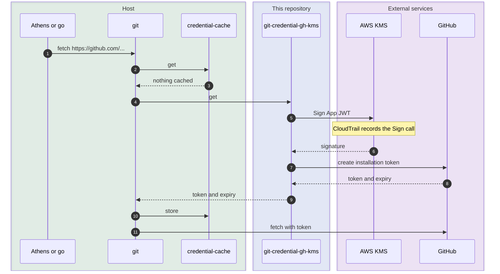

# git-credential-gh-kms

A [git credential helper][gitcredentials] that answers HTTPS requests for GitHub with a GitHub App installation token. The App's private key stays in AWS KMS: the helper signs the App JWT with `kms:Sign`, so no key material is held on the host.

The helper suits long-running services that fetch from GitHub with git, such as the [Athens][athens] Go module proxy. These services otherwise hold a personal access token or the App's private key on disk. With this helper, the private key is imported into KMS once and cannot be extracted. Every signature needs IAM and key policy permission, and CloudTrail records each `Sign` call against the key.

## How it works

The diagram shows git fetching from a private repository, with Git's credential cache in front of this helper.



Later fetches get the token from the cache at step 2 until it expires. The helper declines requests for other hosts and protocols, so git moves on to its next helper.

## Configuration

### KMS key

Create a KMS key with `EXTERNAL` origin, key spec `RSA_2048`, and key usage `SIGN_VERIFY`, then import the GitHub App's private key into it with [`kms-import`][kms-import]. [Protecting the GitHub private key][chinmina-kms] on docs.chinmina.dev covers the key policy, the alias, and rotation. Import the key outside your infrastructure tooling: Terraform's `aws_kms_external_key` stores the key material in plain text in its state.

`kms:Sign` on this key is equivalent to holding the App's private key: it can sign a JWT that mints a token for any installation of the App, with any permission the App has. `GH_TOKEN_REQUEST` narrows only the tokens this helper asks for. Allow `kms:Sign` in the key policy only for the roles that run the helper, and give the App only the permissions those roles need.

### Environment variables

The helper reads its settings from the environment git runs it in. AWS credentials and region come from the standard AWS SDK sources.

| Variable | Required | Meaning |
| -------- | -------- | ------- |
| `GH_APP_ID` | yes | GitHub App ID or Client ID, used as the JWT `iss` |
| `GH_INSTALLATION_ID` | yes | Installation to mint a token for |
| `GH_KMS_KEY_ID` | yes | KMS key ID, ARN, or alias |
| `GH_HOST` | no | Git host to answer for. Defaults to `github.com`. |
| `GH_API_URL` | no | API base URL. Defaults to `https://api.github.com`, or `https://<GH_HOST>/api/v3` for GitHub Enterprise Server. |
| `GH_TOKEN_REQUEST` | no | JSON body for the token request. Defaults to `{"permissions":{"contents":"read"}}`. |

### Git configuration

Register the helper for `github.com` behind Git's credential cache:

```ini
# ~/.gitconfig
[credential "https://github.com"]
    helper =
    helper = cache --timeout=3300
    helper = gh-kms
    useHttpPath = false
```

Installation tokens last one hour. The helper reports an expiry five minutes early, and Git 2.41 and later evict the cached token at that time. A `--timeout` of 3300 seconds (55 minutes) applies the same limit on older git versions. Without the cache, every git request mints a new token and makes a `kms:Sign` call. One installation token covers every repository, so `useHttpPath = false` caches it per host.

`helper =` clears only the helpers set in config files git has already read. Git reads
system, then global (`~/.gitconfig`), then repository config, and asks every helper in
the list to store a token after a successful fetch. Put this block in the last file that
sets a credential helper, usually `~/.gitconfig`. If it goes in `/etc/gitconfig`, a
`helper = store` or `osxkeychain` line in a user's `~/.gitconfig` still runs, and
writes each minted token to disk or the keychain.

[`gitconfig`](gitconfig) is a complete example, which also rewrites SSH remotes to HTTPS.

## Guides

- [Configuring Athens](docs/guides/configure-athens.md) builds an Athens image that fetches private Go modules with this helper.

## Installation

Pre-built binaries for Linux, macOS, and Windows (amd64 and arm64) are published to
[GitHub Releases](https://github.com/chinmina/git-credential-gh-kms/releases). Every artifact
carries a build provenance attestation; see [Verifying releases](#verifying-releases).

<details>
<summary><strong>mise (recommended)</strong></summary>

[mise](https://mise.jdx.dev/) installs from GitHub Releases and verifies the
artifact's checksum and build provenance attestation:

```sh
mise use -g github:chinmina/git-credential-gh-kms
```

</details>

<details>
<summary><strong>Install script</strong></summary>

Each release includes an installer that detects your platform and checks the
download against the checksums embedded in the script:

```sh
curl -fsSL https://github.com/chinmina/git-credential-gh-kms/releases/latest/download/install.sh | sh
```

It installs to `~/.local/bin`. Pass `-b` for another directory. To pin a
version, fetch the script from that release, so its embedded checksums match:

```sh
curl -fsSL https://github.com/chinmina/git-credential-gh-kms/releases/download/v1.2.3/install.sh \
  | sh -s -- -b /usr/local/bin v1.2.3
```

The script has its own attestation. A verified script holds the genuine checksums
for its release and enforces them on the binary, so verifying the script covers
the binary for that release:

```sh
curl -fsSL -O https://github.com/chinmina/git-credential-gh-kms/releases/latest/download/install.sh
gh attestation verify install.sh --repo chinmina/git-credential-gh-kms \
  --signer-workflow chinmina/.github/.github/workflows/goreleaser-release.yml
sh install.sh
```

</details>

<details>
<summary><strong>Homebrew</strong></summary>

```sh
brew install chinmina/tap/git-credential-gh-kms
```

</details>

<details>
<summary><strong>Nix</strong></summary>

```sh
nix profile install github:chinmina/nixpkgs#git-credential-gh-kms
```

</details>

<details>
<summary><strong>Manual download</strong></summary>

Download the archive for your platform, verify its provenance, and put the binary on your `PATH`:

```sh
OS=linux ARCH=amd64   # or darwin/windows, arm64
curl -fsSLO "https://github.com/chinmina/git-credential-gh-kms/releases/latest/download/git-credential-gh-kms_${OS}_${ARCH}.tar.gz"
gh attestation verify "git-credential-gh-kms_${OS}_${ARCH}.tar.gz" --repo chinmina/git-credential-gh-kms \
  --signer-workflow chinmina/.github/.github/workflows/goreleaser-release.yml
tar -xzf "git-credential-gh-kms_${OS}_${ARCH}.tar.gz" git-credential-gh-kms
install -m 0755 git-credential-gh-kms ~/.local/bin/
```

Windows archives are `.zip`.

</details>

<details>
<summary><strong>go install</strong></summary>

Builds from source report the module version Go records, such as `0.1.0` for
`@v0.1.0`, or `dev` when no version is available.

```sh
go install github.com/chinmina/git-credential-gh-kms@latest
```

</details>

## Verifying releases

Release archives and `install.sh` carry a
[build provenance attestation](https://docs.github.com/en/actions/security-for-github-actions/using-artifact-attestations/using-artifact-attestations-to-establish-provenance-for-builds)
created with [Sigstore](https://www.sigstore.dev/) keyless signing. Each artifact
is bound, by digest, to the source commit and the workflow run that built it.
No long-lived signing key exists.

Verify a downloaded artifact with the [GitHub CLI](https://cli.github.com/) (2.49.0 or later):

```sh
gh attestation verify git-credential-gh-kms_linux_amd64.tar.gz --repo chinmina/git-credential-gh-kms \
  --signer-workflow chinmina/.github/.github/workflows/goreleaser-release.yml
```

`--repo` checks the source repository. `--signer-workflow` is required because
the artifacts are signed by the shared release workflow in `chinmina/.github`,
not by a workflow in this repository.

`checksums.txt` lists every archive. After downloading it alongside an archive, check with
`sha256sum --check --ignore-missing checksums.txt`, or `shasum -a 256 --check --ignore-missing checksums.txt` on macOS.

Releases are immutable: once published, their assets cannot be changed and
their tag cannot be moved. GitHub records a release attestation of the tag,
commit, and every asset. Check a downloaded file against it with GitHub CLI
2.81.0 or later:

```sh
gh release verify-asset v1.2.3 git-credential-gh-kms_linux_amd64.tar.gz --repo chinmina/git-credential-gh-kms
```

## Development

`just check` runs formatting, vet, lint and unit tests. `just test-system` runs the
black-box system tests in Docker Compose: the Linux build of the helper signs with
[Local KMS](https://github.com/nsmithuk/local-kms) through the AWS SDK, and a fake
GitHub token endpoint (`cmd/test-support`, not shipped) accepts only JWTs that verify
against the KMS key's public key. The tests are in [`test/system/bats`](test/system/bats).

[gitcredentials]: https://git-scm.com/docs/gitcredentials
[athens]: https://docs.gomods.io/
[kms-import]: https://github.com/chinmina/kms-import
[chinmina-kms]: https://docs.chinmina.dev/guides/kms/
